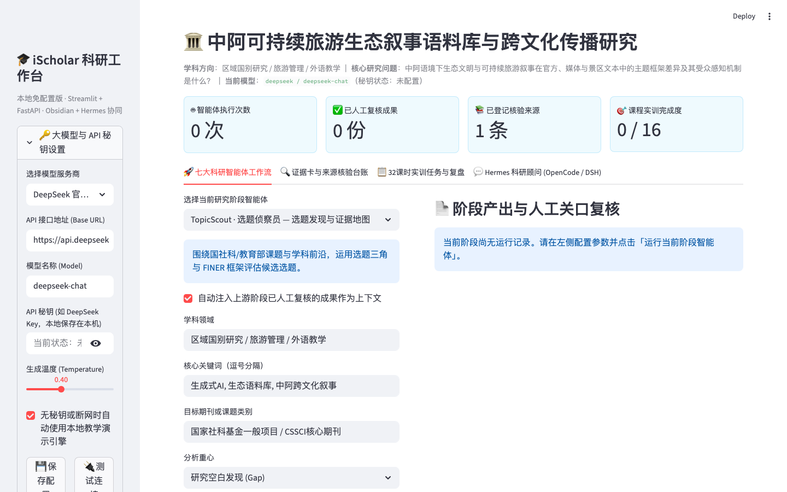
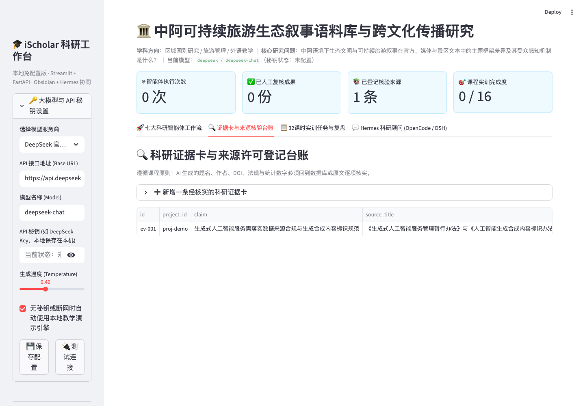
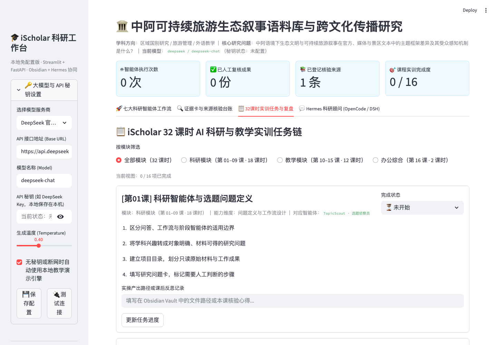
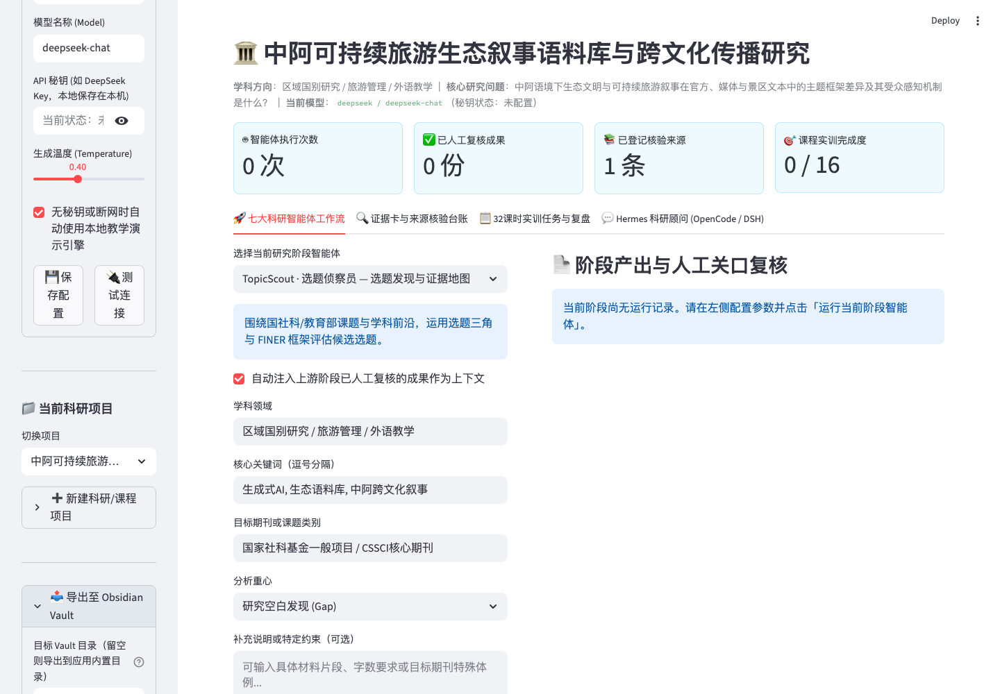

# iScholar · 科研与教学 AI 实训工作台

<p align="center">
  <strong>零翻墙 · 国产与开源优先 · 数据主权可控 · 证据先于流畅文本</strong>
</p>

<p align="center">
  <a href="LICENSE"></a>
  <a href="LICENSE-CONTENT"></a>
  
  
  <a href="https://github.com/liubin18911671739/ischolar/actions"></a>
</p>

> **iScholar** 是一套面向高校人文社科、外语、区域国别与旅游管理教师的 **AI 科研与教学 32 课时实训完整工程**：本地双击即用的科研智能体工作台 + 课程门户 + 52 万字讲义 + Obsidian 科研 Vault 模板 + 14 部软件实操视频。

- 📦 **开源仓库**：本仓库（代码 MIT，课程内容 CC BY-NC-SA 4.0）
- 📺 **B 站视频专栏**：*（上线后替换为合集链接）*
- ✍️ **CSDN 付费专栏**：《AI 赋能科研实战：高校教师的智能体工作流》*（上线后替换为专栏链接）*
- ⬇️ **大文件下载**：见 [docs/downloads.md](docs/downloads.md)（视频、PPT/PDF、课程日历图）

> 本项目中的院校名称、个人姓名与本地路径已做脱敏处理；示例中的「某高校」不代表任何具体院校。课程内容仅用于教学演示，正式研究结论须回到原始来源核验。

---

## ✨ 核心特性

| 能力 | 说明 |
| --- | --- |
| 🧩 **7 大科研智能体** | 选题侦察 → 文献综述 → 研究设计 → 数据分析 → 论文写作 → 期刊匹配 → 审稿回复，全流程串联 |
| 🔍 **人工复核关口** | 上游成果标记「已人工复核」后才注入下游上下文，避免模型幻觉级联 |
| 🔌 **多模型 + 断网回退** | DeepSeek / 通义千问 / Kimi / 智谱 / Ollama / 校内 L20；无网无 Key 可用离线教学演示引擎 |
| 📚 **Obsidian 一键导出** | 按 `00_项目卡 / 01_原始资料 / 02_Agent草稿 / 03_已复核成果 / 04_证据台账` 结构落盘 |
| 🛡️ **本地优先与隐私** | 秘钥仅存本机、默认无遥测、无远程字体、不代管用户数据 |
| 🎓 **32 课时实训体系** | 16 次课任务链、5 大专题、18 份模板、6 个 Hermes Skills |

---

## 📸 界面预览

> 截图位于 `docs/images/`，随首次发布补充；也可直接按「快速开始」在本地启动查看。

| 工作台首页 | 证据与复核台账 |
| :---: | :---: |
|  |  |

| 32 课时任务链 | Obsidian 导出 |
| :---: | :---: |
|  |  |

---

## 🚀 快速开始

### 方式一：双击启动（推荐，免配置）

- **macOS**：双击 `ischolar/启动iScholar.command`
- **Windows**：双击 `ischolar/启动iScholar.bat`

启动器会自动检测 Python 环境（优先已安装环境 → `uv` → 创建 `.venv` 并从国内镜像安装依赖），随后拉起：

- Streamlit 交互前端：<http://127.0.0.1:8501>
- FastAPI 接口文档：<http://127.0.0.1:8765/docs>

在左侧边栏填入 **DeepSeek / 通义千问 / Kimi / 智谱** 秘钥，或选择 **Ollama 本地模型 / 离线教学演示引擎**，即可运行全部 7 大智能体。

### 方式二：命令行

```bash
git clone https://github.com/liubin18911671739/ischolar.git
cd ischolar/ischolar
./启动iScholar.command        # macOS / Linux
# 或
python launcher.py             # 需 Python 3.9+
```

端口可用环境变量覆盖：`ISCHOLAR_BACKEND_PORT`、`ISCHOLAR_FRONTEND_PORT`；设置 `ISCHOLAR_NO_BROWSER=1` 可禁止自动打开浏览器。

### 方式三：课程门户网站

要求 Node.js 22（推荐）或兼容的 Node.js 24：

```bash
cd website
npm ci
npm run dev          # http://localhost:3000
```

检查与构建：

```bash
npm run check        # ESLint + TypeScript + 课程/资源内容一致性校验
npm run build        # 生产构建与静态预渲染
npm run test:e2e     # Playwright 多浏览器 + axe WCAG 2.2 无障碍测试
```

### 运行后端测试

```bash
cd ischolar
python -m pytest tests -q
```

测试使用临时数据库，不会写入真实 `ischolar/data/`。需 Python 3.9+（推荐 3.10+）。

### 一键回归与打包

```bash
./scripts/check-all.sh                 # ischolar pytest + website check/build
./scripts/package-and-sync.sh          # 重新打包 4 个 zip + SHA256SUMS.txt
```

---

## 🏗️ 系统架构

```text
┌────────────────────────────────────────────────────────────────────────────┐
│                        🧠 模型路由层 (OpenAI 兼容接口)                       │
│   DeepSeek / 通义千问 / Kimi / 智谱 GLM │ Ollama 本地模型 │ 校内 L20 │ 离线演示引擎 │
├────────────────────────────────────────────────────────────────────────────┤
│                     ⚙️ 智能体与工作台层 (Dual Workbench)                     │
│  [iScholar 本地应用 (Streamlit:8501 + FastAPI:8765)]   [Hermes Agent / CLI] │
│  • 7大阶段科研智能体 + 上游已复核成果注入               • OpenCode / DSH 宿主 │
│  • 教师人工复核关口 + 科研证据与来源许可台账            • 科研专用 Skills 库   │
├────────────────────────────────────────────────────────────────────────────┤
│                     📚 本地知识中台层 (Obsidian Vault)                      │
│  00_项目卡 │ 01_原始资料_只读 │ 02_工作区_Agent草稿 │ 03_已复核成果 │ 04_证据台账 │
│  联动工具：Zotero 7 (题录同步) · jamovi / JASP (统计) · AntConc (语料库)     │
├────────────────────────────────────────────────────────────────────────────┤
│                     🌐 课程门户与资源层 (Website:3000)                      │
│  16次课(32课时)日历 │ 5大专题指南 │ 18份可下载模板 │ 浏览器本地进度与来源登记 │
└────────────────────────────────────────────────────────────────────────────┘
```

---

## 📂 项目结构

```text
ischolar/
├── ischolar/                                  # 1. 本地科研智能体工作台 (v6.2.0)
│   ├── 启动iScholar.command / .bat            #    macOS / Windows 双击启动器
│   ├── launcher.py                            #    守护进程启动器（FastAPI:8765 + Streamlit:8501）
│   ├── pyproject.toml / requirements.txt      #    Python 依赖声明
│   ├── app/
│   │   ├── backend.py                         #    FastAPI 后端（SQLite + 多模型路由 + Obsidian 导出）
│   │   ├── frontend.py                        #    Streamlit 前端（秘钥配置 + 7 大 Agent + 证据台账）
│   │   └── prompts.py                         #    7 大智能体提示词 / JSON 解析 / 离线演示引擎 / 16 课任务链
│   └── tests/                                 #    后端回归测试
├── website/                                   # 2. 课程宣传与资源门户 (Next.js 16)
│   ├── src/app/                               #    首页 / 日历 / 16 课详情 / 5 专题 / 资源 / 搜索 / 关于
│   ├── src/components/                        #    响应式导航、日历筛选、模板下载、本地记录等
│   ├── src/content/                           #    site.ts / courses.ts / resources.ts / guides.ts
│   ├── src/lib/                               #    localStorage 状态管理与 CSV/MD/JSON 下载
│   ├── scripts/validate-content.ts            #    内容一致性校验
│   └── tests/                                 #    Playwright E2E 与 axe 无障碍测试
├── training-plan/                             # 3. 32 课时培训方案（脱敏版）
│   ├── AI培训计划方案.docx                    #    培训方案 Word 定稿
│   └── ..._全文讲稿与版式说明.md              #    汇报课件逐页讲稿
├── lectures/                                  # 4. 讲义与 Obsidian 科研 Vault
│   ├── 核心讲义_Obsidian_Hermes版/            #    15 份 Notion 风格核心讲义
│   ├── 专题实战讲义_Obsidian_Hermes重构版/    #    13 份模块化深度实战讲义
│   └── obsidian-vault-template/               #    标准科研 Vault（5 份笔记模板 + 6 个 Hermes Skills）
├── software-and-videos/                       # 5. 国产 / 开源软件工具包与视频说明
│   ├── 01_国产与开源软件工具包/               #    软件清单、随包 zip、macOS 环境脚本
│   └── 02_软件实操教学视频/                   #    14 部视频的状态表与录制脚本（视频见下载页）
├── docs/downloads.md                          # 大文件下载索引（Releases / 网盘）
├── scripts/                                   # check-all.sh / package-and-sync.sh
└── README.md / TODO.md
```

> **未随仓库分发**：14 部 MP4 实操视频、PPTX/PDF 汇报课件、课程日历 PNG、13 份第三方原版参考 PDF。前四类可在 [docs/downloads.md](docs/downloads.md) 获取；第三方原版 PDF 因版权原因不公开分发。

---

## 🧠 核心模块详解

### 1. `ischolar/` 本地科研智能体工作台

**七大阶段科研智能体**：

1. `TopicScout`（选题侦察员）：基于选题三角与 FINER 框架生成 3 个候选选题及三维评分。
2. `LitReview`（文献综述员）：生成中英阿检索式、文献综述矩阵与漏斗式综述草稿，强制提示回源核验。
3. `ResearchDesigner`（方法设计员）：生成研究设计一页纸、研究假设、变量框架与偏差/伦理控制清单。
4. `DataPilot`（数据与语料分析员）：输出语料清洗 SOP、jamovi/JASP/AntConc 操作指南与可复现 Python 脚本。
5. `IMRaDWriter`（论文模块化写作员）：支持 CARS 引言模型、IMRaD 各章节写作、中英润色与去 AI 腔自查。
6. `SubmitMatch`（期刊匹配与投稿员）：提供冲刺/匹配/保底三档选刊建议、Cover Letter 与投稿合规核验表。
7. `RebuttalShow`（审稿回复与复盘员）：拆解审稿人意见，生成带正文修改定位的 Point-by-Point 回复表。

**关键机制**：

- **人工复核关口与上下文串联**：每个阶段产出需经教师核对原文后标记为「已人工复核」，才会被自动注入下游智能体上下文。
- **多模型支持与断网回退**：内置 DeepSeek、阿里云百炼（通义千问）、月之暗面 Kimi、智谱 GLM、本地 Ollama、校内 L20 推理网关，以及本地离线教学演示引擎（无需网络或 API Key 即可完整演示教学流程）。
- **一键导出 Obsidian Vault**：按 `00_项目卡`、`01_原始资料_只读`、`02_工作区_Agent草稿`、`03_已复核成果`、`04_证据与来源台账` 标准结构导出 Markdown 文件；同名文件自动备份。

后端主要接口：

| 方法 | 路径 | 说明 |
| --- | --- | --- |
| `GET` | `/v1/health` | 服务健康状态与当前模型配置 |
| `GET` / `POST` | `/v1/providers` | 读取 / 保存模型服务商与秘钥配置（秘钥仅保存在本机） |
| `POST` | `/v1/providers/test` | 测试当前模型连接是否可用 |
| `GET` / `POST` | `/v1/projects` | 列出 / 新建科研项目 |
| `POST` | `/v1/agent/run` | 运行指定阶段智能体（自动注入上游已复核成果） |
| `POST` | `/v1/runs/{run_id}/approve` | 标记运行结果为已复核 / 待重新核查 |
| `GET` / `POST` | `/v1/evidences` | 查询 / 新增证据卡与来源许可记录 |
| `GET` | `/v1/training/tasks` | 读取 32 课时实训任务与完成状态 |
| `POST` | `/v1/projects/{project_id}/export-obsidian` | 导出项目全部成果至 Obsidian Vault 结构 |
| `POST` | `/v1/hermes/chat` | Hermes 科研工作流顾问对话 |

### 2. `website/` 课程门户与 32 课时体系

课程遵循 **8 周 × 每周 2 次 × 每次 2 小时 = 32 小时** 标准口径：

| 模块划分 | 专题模块 | 课次范围 | 课时 | 核心交付物与配套资源 |
| :--- | :--- | :---: | :---: | :--- |
| **科研模块 (18h)** | 科研智能体与论文工程 | 第 01–06 课 | 12h | 研究项目卡、检索与核验表、研究设计一页纸、Obsidian+Hermes 配置、选刊与审稿回复表 |
| **科研模块 (18h)** | 多语种生态语料库 | 第 07–09 课 | 6h | 语料库建库方案卡、清洗与脱敏 SOP、双人抽检表、AntConc/jamovi/Python 分析小样 |
| **教学模块 (12h)** | 教学内容生产与微课 | 第 10–13 课 | 8h | 课程大纲、双语词汇讲义、分级阅读与测试题、数字人/音视频授权核验、微课脚本 |
| **教学模块 (12h)** | 图像化与高审美 PPT | 第 14–15 课 | 4h | 信息图版式结构说明、前后对比改造样例、组图风格规范卡 |
| **办公综合 (2h)** | 办公应用与校内模型协同 | 第 16 课 | 2h | 通知/纪要/申报书检查清单、个人 AI 工具组合表、学期行动计划 |

门户特性：16 次课独立详情页、日历周/列表视图与模块筛选、5 大专题页、18 份模板下载、浏览器本地进度与来源登记（`localStorage` 键名 `ischolar-workbench:v1`，支持 JSON 导入恢复与自动备份）、打印视图、本地搜索、404、键盘导航与 axe WCAG 2.2 A/AA 自动扫描；无远程字体、无分析统计、无模型代理。

### 3. `lectures/` 讲义与 Obsidian 科研 Vault

- **核心讲义（15 份）**：课程总纲、索引与第 01–10 课。每课统一包含课程属性卡、Callout 区块（学习目标 / 软件工具箱 / 视频跟练 / 概念解析 / 避坑警告 / 验收清单 / 常见问题）、软件下载与使用方法专节、课堂任务卡与可量化验收标准。
- **专题实战讲义（13 份）**：中文检索、英文检索、Zotero×Obsidian 联动与可视化、研究设计基础与进阶、Excel/jamovi/JASP、Python 进阶分析、GPU 与 Ollama 本地部署、模块化写作、投稿工程、Rebuttal 写作、学术展示与课题申报。
- **Obsidian 科研 Vault 模板**：标准目录规范、5 份笔记模板、6 个 Hermes Skills（`obsidian-search`、`zotero-query`、`topic-scout`、`literature-review`、`paper-writer`、`rebuttal-helper`）。

---

## 📥 大文件与配套资源

完整视频、PPT/PDF、课程日历图与网盘工具包见 **[docs/downloads.md](docs/downloads.md)**。

---

## 🔐 数据安全与学术合规边界

1. **三级数据分流原则**：
   - **公开资料**（公开论文、政策法规、开源语料）：可使用经备案的国产商用大模型 API。
   - **校内教学与未公开科研草稿**：优先使用校内 L20 平台或本地离线 Ollama 模型。
   - **涉密、未授权个人信息与版权受限教材**：严禁上传任何外部 API 或公共云平台。
2. **秘钥与隐私**：API Key 仅保存在本机 `ischolar/data/provider_settings.json`，前端仅显示掩码；该文件已被 `.gitignore` 排除，**请勿提交或随包分发**。
3. **证据先于流畅文本**：所有由模型生成的引文、DOI、法规条款与统计数据均须回到中国知网（CNKI）、OpenAlex 或原始档案核验，并在《证据与来源台账》中完成人工复核登记。
4. **模型不等于结论**：模型提供初稿与备选方案，研究判断、课程评价与正式发布由责任人确认。

---

## 🤝 参与贡献

欢迎提交 Issue 与 Pull Request：见 [CONTRIBUTING.md](CONTRIBUTING.md)。安全问题请勿公开提交 Issue，处理方式见贡献指南。

## 📄 许可

- **代码**（`ischolar/`、`website/`、`scripts/` 等）：[MIT](LICENSE)
- **课程内容**（`lectures/`、`training-plan/`、`docs/` 等讲义与文档）：[CC BY-NC-SA 4.0](LICENSE-CONTENT)

你可以自由使用、修改与分发代码（保留版权声明）；课程内容可署名非商业性分享，改编需采用相同许可。商业培训或专栏合作请联系作者。

## 🙏 致谢

感谢 Obsidian、Zotero、Ollama、jamovi、JASP、AntConc、Taguette、OpenCode 等开源项目，以及 DeepSeek、通义千问、Kimi、智谱等国产模型服务。课程中的第三方软件与资料版权归原作者所有。

---

## 相关文档

- 大文件下载：[docs/downloads.md](docs/downloads.md)
- 开发说明（数据目录、端口、重置）：[ischolar/README.md](ischolar/README.md)
- 全项目待办与路线：[TODO.md](TODO.md)
- 门户网站说明：[website/README.md](website/README.md)
- 内容维护指南：[website/docs/CONTENT_GUIDE.md](website/docs/CONTENT_GUIDE.md)
- 部署说明：[website/docs/DEPLOYMENT.md](website/docs/DEPLOYMENT.md)
- 工程验证记录：[website/docs/VERIFICATION.md](website/docs/VERIFICATION.md)
