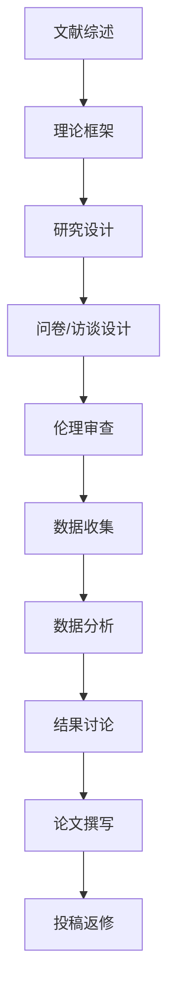

# 第03课｜科研智能体创建

> [!abstract] 🎯 本课定位
> 上一课你有了一个“什么都能聊”的通用助手。但科研需要的是**分工明确的专家**：查文献的专心查文献，改语言的专心改语言。
>
> **学完你将拥有**：6 个科研 Agent 的 Profile 骨架、1 个自己写的 Skill、1 张能贴进开题报告的技术路线图。

> [!info] 📌 本课核心公式
> **Agent = Profile（身份与模型）+ Skills（怎么做）+ Memory（记住什么）+ Tools（能碰什么）。**
> 绝大多数“AI 不好用”的问题，根源是**没写 Profile**——你让一个没有身份的模型同时当审稿人、翻译和统计员。

---

## 🧰 一、本课软件工具箱（下载 · 安装 · 备份）

| 工具 | 用途 | 官方地址 | 国内加速 / 说明 | 百度网盘备份 |
| :-- | :-- | :-- | :-- | :-- |
| **Hermes Agent** | 运行 Agent 的宿主 | <https://github.com/NousResearch/hermes-agent> | 已于第 02 课安装 | `/iScholar课程/软件与视频工具箱/01_国产与开源软件工具包/` |
| **OpenCode** | 终端内 AI 工程宿主（可生成 Mermaid 图） | <https://opencode.ai> | 官网直连 | 同上 |
| **Mermaid** | 文本画流程图，Obsidian 原生支持 | <https://mermaid.js.org> | 官网可访问；有中文文档镜像 | 同上 |
| **Draw.io（diagrams.net）** | 在线/离线流程图，免登录 | <https://app.diagrams.net> | 国内可直连；可下载桌面版 | 同上 |
| **Excalidraw** | 手绘风格示意图，适合答辩 PPT | <https://excalidraw.com> | 国内可直连 | 同上 |
| **课程 Skills 包** | 6 个现成科研 Skills | 本地 `lectures/obsidian-vault-template/skills/` | — | `Obsidian_科研Vault标准模板与Hermes技能包.zip` |

> [!example] 🎬 配套实操视频
> - **`02_Obsidian科研Vault与Hermes智能体配置教程.mp4`**：Obsidian 内唤起 Hermes，让它读写 Vault。
> - **`06_Mermaid_Drawio_Excalidraw与OpenCode技术路线图绘制.mp4`**（1 分 24 秒）：从 `mermaid.js.org` 语法→`app.diagrams.net` 在线绘图→`app.excalidraw` 手绘→**OpenCode（`MiMo-V2.6-Flash`）自动生成 10 步方法流程图**并导出 PNG。

---

## 🤖 二、为什么要拆成 6 个 Agent

### 2.1 单 Agent 的三个失败模式

| 现象 | 根因 | 拆分后的解法 |
| :-- | :-- | :-- |
| 让它写文献综述，它开始给你编参考文献 | 写作模式与检索模式混在一起 | `literature-review` 只做检索与综合，强制标注“待核验” |
| 让它改语言，它把论点也改了 | 没有明确的“只改表达不改内容”约束 | `paper-writer` 的 Skill 里写死边界 |
| 让它评选题，它夸得天花乱坠 | 没有评估框架 | `topic-scout` 强制走选题三角 + FINER |

> [!info] 拆分不是为了炫技，是为了**让约束可执行**
> 一个 Profile 里的 system_prompt 越具体，模型跑偏的概率越低。6 个 Agent 就是 6 套不同的“岗位说明书”。

### 2.2 本课程的 6 个科研 Agent

| # | Agent | 职责 | 温度 | 核心 Skills |
| :-- | :-- | :-- | :--: | :-- |
| 1 | `literature-agent` | 文献检索、摘要结构化、对比分析 | 0.3 | `obsidian-search`、`zotero-query`、`literature-review` |
| 2 | `topic-agent` | 选题发现、Gap 分析、FINER 评估 | 0.7 | `topic-scout`、`obsidian-search` |
| 3 | `design-agent` | 方法选择、问卷/访谈提纲、技术路线 | 0.5 | `topic-scout`、`obsidian-search` |
| 4 | `analysis-agent` | 统计方法选择、代码生成、结果解读 | 0.2 | `paper-writer`（结果段）、`obsidian-search` |
| 5 | `writing-agent` | 模块化写作、三级润色、格式规范 | 0.4 | `paper-writer`、`literature-review` |
| 6 | `submission-agent` | 选刊、Cover Letter、Rebuttal | 0.5 | `rebuttal-helper`、`paper-writer` |

> [!tip] 温度怎么选
> - **0.2–0.3**：需要稳定、可复现（统计分析、文献提取）
> - **0.4–0.5**：需要平衡（写作、研究设计）
> - **0.6–0.7**：需要发散（选题 brainstorm）
> - **>0.8**：科研场景基本不用，容易胡说

---

## 🗂️ 三、Profile 创建实操

### 3.1 目录与命令

```text
~/.hermes/profiles/
├── default/
├── literature-agent/
├── topic-agent/
├── design-agent/
├── analysis-agent/
├── writing-agent/
└── submission-agent/
```

```bash
hermes profile create literature-agent
hermes profile create topic-agent
hermes profile create design-agent
hermes profile create analysis-agent
hermes profile create writing-agent
hermes profile create submission-agent

hermes profile list
```

### 3.2 一个完整的 Profile 示例（文献 Agent）

`~/.hermes/profiles/literature-agent/config.yaml`：

```yaml
name: "文献Agent"
description: "专注于文献检索、摘要生成与对比分析的科研助手"
model: "deepseek-chat"
temperature: 0.3

system_prompt: |
  你是专业的学术文献助手，服务对象是高校文科教师。
  你的职责：
  1. 帮助拆解研究问题，构建中英文检索式；
  2. 生成结构化文献卡片（题名/作者/年份/期刊/方法/发现/局限）；
  3. 做文献对比分析，识别共识、分歧与研究空白。

  硬性约束：
  - 不得虚构文献条目；不确定的字段写「待回源核验」；
  - 每条文献必须给出可核验的检索线索（DOI、期刊、卷期或数据库名称）；
  - 区分「原文陈述」与「你的推断」，后者用「推断：」标注；
  - 中文输出，专业术语保留英文原文。

skills:
  - obsidian-search
  - zotero-query
  - literature-review

tools:
  - read_file
  - write_file
  - search_files
  - web_search
  - web_extract
```

### 3.3 其余 5 个 Profile 的关键差异

| Agent | system_prompt 关键句 | 温度 | 特殊约束 |
| :-- | :-- | :--: | :-- |
| topic-agent | “用选题三角与 FINER 评估，必须给出 3 个候选并说明放弃理由” | 0.7 | 不得把“热点”等同于“空白” |
| design-agent | “对齐 RQ—分析单位—材料—方法，输出一页纸” | 0.5 | 必须列出偏差与伦理风险 |
| analysis-agent | “先问数据类型与假设，再给方法与代码” | 0.2 | 不得在未检查前提时直接给 t 检验 |
| writing-agent | “只改表达，不改论点；保留 `[@待核验]` 占位” | 0.4 | 不得补写未提供的实证结果 |
| submission-agent | “按冲刺/匹配/保底三档选刊，给出合规清单” | 0.5 | 期刊信息需标注年份与来源 |

### 3.4 课堂练习

- [ ] 建 3 个 Profile（literature / topic / writing）
- [ ] 为 `writing-agent` 写 system_prompt，包含 3 条“不得”
- [ ] `hermes profile use writing-agent` 后测试：
      “把这句话改得更学术，但不要改变我的观点：AI 对学生写作有帮助。”

> [!success] 判断是否成功
> 好的改写应保留你的核心判断，只在措辞、衔接、术语精确度上变化；如果它给你加了“显著提升”“实证表明”等未经你验证的结论，说明约束不够。

---

## 🧩 四、Skill 编写：把方法论固化成文件

### 4.1 `SKILL.md` 标准结构

```markdown
---
name: skill-name
description: "Use when <触发条件>. <一句话行为描述>."
version: 1.0.0
author: AI4S Course
license: MIT
created: 2026-09-17
updated: 2026-11-15
type: 笔记
---

# Skill 名称

## 功能 / 使用场景
## 分析模型（表格或流程）
## Prompt Templates（可直接复制的提示词）
## Workflow（步骤）
## Output Location（结果写到哪）
## Quality Checklist（质量核查清单）
```

> [!warning] description 字段决定 Skill 会不会被调用
> Hermes 靠 `description` 判断“什么时候该用这个技能”。写法必须是：**“Use when <场景>. <做什么>.”**，不要写成“这是一个关于XX的技能”。

### 4.2 课程内置的 6 个 Skills

| Skill | 触发场景 | 产出 |
| :-- | :-- | :-- |
| `obsidian-search` | 要在 Vault 里找/建/改笔记 | 文件路径与内容摘要 |
| `zotero-query` | 要按主题/作者查 Zotero 题录 | 文献卡片 |
| `topic-scout` | 要发散选题、验 Gap、跑 FINER | 3 个候选选题 + 三维评分 + JSON |
| `literature-review` | 要写综述段落或做 Gap 分析 | OCAR / 漏斗结构综述 |
| `paper-writer` | 要按 IMRaD 写某一节 | 章节草稿 + 引用占位 |
| `rebuttal-helper` | 要回复审稿意见 | Point-by-Point 回复表 |

安装位置：

```bash
# 全局技能
cp -r lectures/obsidian-vault-template/skills/* ~/.hermes/skills/

# 或只给某个 Profile
cp -r lectures/obsidian-vault-template/skills/topic-scout ~/.hermes/profiles/topic-agent/skills/
```

### 4.3 示例：自己写一个 `gap-analysis`

**任务**：创建一个“研究空白分析”Skill，输入一批文献卡片，输出四类 Gap。

```markdown
---
name: gap-analysis
description: "Use when the user has a set of papers and needs to identify research gaps. Outputs methodological, contextual, theoretical and temporal gaps."
version: 1.0.0
author: 你的名字
license: MIT
---

# Gap Analysis

## 使用场景
已读完 5–20 篇文献，需要判断“还能研究什么”。

## 四类空白
| 类型 | 问法 | 例子 |
| :-- | :-- | :-- |
| 方法论空白 | 哪些方法没被用过？ | 现有研究多为问卷，缺语料库+访谈混合设计 |
| 语境空白 | 哪些语种/地区/人群没覆盖？ | 多集中英美，缺阿拉伯语与中阿对比 |
| 理论空白 | 哪些关系没被检验？ | 未检验“AI 使用强度→自我效能→写作质量”中介 |
| 时间空白 | 近两年新现象是否跟进？ | 生成式 AI 普及后的数据极少 |

## Prompt Template
请基于以下文献信息，分别从方法论、语境、理论、时间四类识别研究空白。
每条空白必须：①引用支持它的具体文献；②说明为什么这构成空白；③指出验证该空白需要补检的数据库与检索式；④标注尚未验证之处。

文献信息：
[粘贴文献卡片]

## Output Location
`01-选题池/YYYY-MM-DD_Gap分析_<主题>.md`

## Quality Checklist
- [ ] 每条空白都有文献支撑，不是主观猜测
- [ ] 区分了“没人做”与“做了但没做好”
- [ ] 给出了可执行的补检方案
```

### 4.4 课堂练习

- [ ] 复制上面的模板，改成你自己的学科版本（换掉例子）
- [ ] 放进 `~/.hermes/profiles/topic-agent/skills/gap-analysis/SKILL.md`
- [ ] 用 3 篇真实文献测试，检查它是否真的引用了你给的文献

> [!warning] 测试时重点看什么
> 如果它给出的“空白”在你提供的 3 篇文献里根本找不到依据，说明 Skill 的约束没生效——回去把“必须引用具体文献”写得更硬。

---

## 🛠️ 五、Tools 与权限

### 5.1 常用工具

| 工具 | 能力 | 风险 |
| :-- | :-- | :-- |
| `read_file` | 读指定文件 | 低 |
| `write_file` | 写新文件 | 中（可能覆盖） |
| `search_files` | 按内容/文件名搜 | 低 |
| `web_search` | 联网检索 | 中（可能引入未核验信息） |
| `web_extract` | 提取网页正文 | 中 |
| `terminal` | 执行 Shell 命令 | **高**（可删文件） |
| `skill_manage` | 增删改 Skill | 中 |

### 5.2 最小权限原则

```yaml
tools:
  - read_file
  - write_file
  - search_files
  - web_search
```

> [!warning] 关于 `terminal`
> 课堂练习阶段**不要**给 Agent 开 `terminal`。它真的会执行 `rm`。等你熟悉了再用，并且明确限定工作目录。

---

## 🧭 六、delegate_task：把大任务拆开

### 6.1 适用场景

- 一次分析 5 篇文献（每篇一个子任务）
- 同时检索 3 个主题
- 一边检索一边起草（两条独立线）

### 6.2 用法

```text
用户：帮我同时分析这 5 篇文献
Agent：拆成 5 个子任务 → 并行执行 → 汇总为对比表
```

```python
delegate_task(tasks=[
  {"type": "literature_analysis", "file": "文献1.md"},
  {"type": "literature_analysis", "file": "文献2.md"},
  {"type": "literature_analysis", "file": "文献3.md"},
])
```

> [!warning] 成本提醒
> 每个子任务都是一次模型调用。先单篇测试效果，再批量跑，否则容易一次烧掉几十次调用。

---

## 📐 七、技术路线图：三种画法

> [!example] 对应视频 `06`
> 视频演示了完整链路：Mermaid 语法 → diagrams.net 在线编辑 → Excalidraw 手绘 → OpenCode 自动生成 10 步方法流程图并导出 PNG。

### 7.1 Mermaid（推荐，Obsidian 原生）

````markdown

````

### 7.2 Draw.io / Excalidraw（适合答辩 PPT）

- **Draw.io**：<https://app.diagrams.net> → 新建 → 流程图 → 导出 PNG/SVG（透明背景）。
- **Excalidraw**：<https://excalidraw.com> → 手绘风格 → 导出 PNG，贴进 PPT 更有“人味”。

### 7.3 让 Agent 帮你画

```text
请用 Mermaid 语法画一个研究技术路线图，包含 8 个阶段，
标注每个阶段的时间节点（月）与关键里程碑，输出可直接粘贴到 Obsidian 的代码块。
```

> [!tip] 验收标准
> 图能不看讲解就懂：**箭头方向 = 研究推进方向**，每个框里是**动作**而不是名词堆砌。

---

## ✅ 八、课堂验收清单

- [ ] 6 个 Profile 至少建成 3 个，`hermes profile list` 可见
- [ ] `writing-agent` 的 system_prompt 含至少 3 条“不得”
- [ ] 1 个自定义 Skill 写入 `skills/`，并能被触发
- [ ] 1 张 Mermaid 技术路线图能在 Obsidian 中正常渲染
- [ ] 能解释：为什么 analysis-agent 的温度要设成 0.2

> [!success] ✅ 本课交付物
> | 交付物 | 位置 |
> | :-- | :-- |
> | Profile 配置 | `~/.hermes/profiles/*/config.yaml` |
> | 自定义 Skill | `~/.hermes/profiles/topic-agent/skills/gap-analysis/SKILL.md` |
> | 技术路线图 | `03-研究设计/技术路线图.md` |

---

## ❓ 九、常见问题

> [!question] Q1：6 个 Agent 必须全建吗？
> 不必。先建 `writing-agent` 和 `topic-agent` 两个最常用的，其余按需。Profile 建多了反而记不住谁是谁。

> [!question] Q2：Skill 和 system_prompt 有什么区别？
> system_prompt 是**始终生效的身份约束**；Skill 是**按需加载的操作手册**。前者管“你是谁”，后者管“这一步怎么做”。

> [!question] Q3：Skill 写多长合适？
> 一屏到两屏。超过 300 行通常说明你把多个技能混在一起了，应该拆开。

> [!question] Q4：Agent 会改坏我的笔记吗？
> 会，如果你给了 `write_file` 又不限定目录。建议：①原始资料目录设为只读；②让它在 `02_工作区_Agent草稿/` 里写；③定期 Git 提交。

> [!question] Q5：怎么知道 Skill 被调用了？
> Hermes 会在输出里显示加载了哪个 Skill。如果没显示，检查 `description` 是否写清了触发条件。

---

> [!quote] 本课一句话
> **不要指望一个模型什么都会；把方法论写成 Skill，才是把“经验”变成“可复用的生产力”。**
