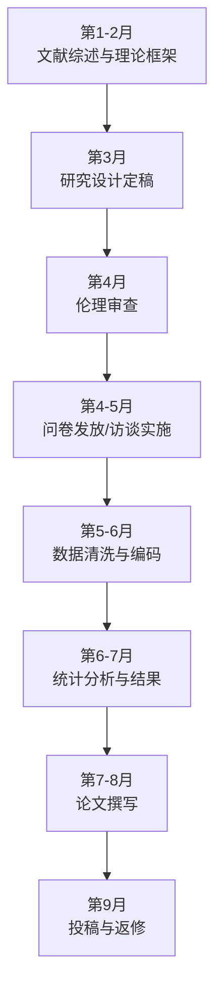

# 第05课｜AI 辅助选题与研究设计

> [!abstract] 🎯 本课定位
> 前面四课解决“读什么”，这一课解决“研究什么、怎么研究”。选题选错，后面全白做；设计不严，数据再漂亮也发不出去。
>
> **学完你将拥有**：一个经得起追问的研究问题、一页纸研究设计、一张技术路线图，以及一份可以立刻去访谈或发问卷的工具初稿。

> [!warning] ⚠️ 本课最容易犯的错
> **把“热点”当成“空白”。** AI 很擅长告诉你“AI+教育很热”，但热不等于没人做。真正的 Gap 必须用文献分布证明，不是用模型语气证明。

---

## 🧰 一、本课软件工具箱（下载 · 安装 · 备份）

| 工具 | 用途 | 官方地址 | 国内可用性 | 百度网盘备份 |
| :-- | :-- | :-- | :-- | :-- |
| **DeepSeek / 通义千问** | 选题发散、Gap 检验、RQ 改写 | <https://chat.deepseek.com> / <https://tongyi.aliyun.com> | 国内直连 | — |
| **iScholar 工作台** | `TopicScout` 与 `ResearchDesigner` 智能体 | 本地 `ischolar/` | 双击即用 | `iScholar_v6.2_...zip` |
| **Hermes `topic-scout`** | 选题三角 + FINER 的结构化分析 | 本地 `lectures/obsidian-vault-template/skills/topic-scout/` | 已随包 | `Obsidian_科研Vault标准模板与Hermes技能包.zip` |
| **Taguette** | 免费开源质性文本编码（访谈/开放题） | <https://www.taguette.org> / <https://app.taguette.org> | 国内可直连网页版 | `/iScholar课程/软件与视频工具箱/01_国产与开源软件工具包/` |
| **Credamo 见数** | 问卷设计、样本服务、SurveyGPT | <https://www.credamo.com> | 国内直连 | —（在线服务） |
| **问卷星** | 快速发问卷、回收数据 | <https://www.wjx.cn> | 国内直连 | —（在线服务） |
| **SPSSAU** | 零代码在线统计 | <https://spssau.com> | 国内直连 | —（在线服务） |
| **SPSSPRO** | 零代码在线统计（备选） | <https://www.spsspro.com> | 国内直连 | —（在线服务） |
| **Mermaid** | 文本画技术路线图（Obsidian 原生） | <https://mermaid.js.org> | 可访问 | 同上 |
| **Draw.io** | 在线流程图，免登录 | <https://app.diagrams.net> | 国内可直连 | 同上 |
| **Excalidraw** | 手绘风格示意图 | <https://excalidraw.com> | 国内可直连 | 同上 |

> [!example] 🎬 配套实操视频
> - **`06_Mermaid_Drawio_Excalidraw与OpenCode技术路线图绘制.mp4`**：三种画法对比 + OpenCode 自动生成 10 步流程图。
> - **`08_Taguette开源质性研究访谈文本编码工具实操.mp4`**（50 秒）：`app.taguette.org` 新建项目 → 导入访谈稿 → 打标签编码 → 导出。
> - **`09_见数_问卷星调研设计与SPSSAU_SPSSPRO零代码统计分析.mp4`**（1 分 04 秒）：Credamo 创建问卷（含 SurveyGPT）→ 问卷星入口 → SPSSAU 上传 Excel → SPSSPRO 在线分析。

---

## 🎯 二、选题三角：三个条件缺一不可

```text
        Gap（学术空白）
           /\
          /  \
         /    \
        /  选题  \
       /________\
Feasibility      Venue
（可行性）      （发表去向）
```

| 缺什么 | 表现 | 后果 | 补救 |
| :-- | :-- | :-- | :-- |
| 缺 Gap | 题目很顺，但一搜已有 50 篇 | 重复研究，初审被拒 | 换语境、换方法、换理论视角 |
| 缺 Feasibility | 想法宏大，数据拿不到 | 做不完，或样本太小 | 缩小范围、限定对象与时间 |
| 缺 Venue | 做得很扎实，但无处可投 | 成果沉睡 | 调整研究角度贴合目标期刊栏目 |

### 2.1 文科教师的三角优势

| 维度 | 你的优势 | 用法 |
| :-- | :-- | :-- |
| Gap | 你懂学科内在逻辑，能识别“伪热点” | 用学科史判断哪些问题是真问题 |
| Feasibility | 你有课堂、学生、合作校、地方文化资源 | 把“可及样本”变成研究设计的一部分 |
| Venue | 你熟悉本学科期刊生态 | 先定期刊，再定写法 |

---

## 🌱 三、AI 辅助选题三步法

### 3.1 第一步：发散（3 个候选，不是 10 个）

```text
我是 [学科] 高校教师，研究兴趣包括 [兴趣1]、[兴趣2]。
可支配时间约 [X 个月]，可获取材料为 [公开语料/问卷/访谈/档案]，
目标发表去向为 [CSSCI / 北核 / SSCI / 校级课题]。

请完成选题发散：
1. 给出 3 个候选选题（不要 10 个，避免稀释判断力）；
2. 每个选题包含：一句话描述、核心 RQ、Gap、潜在创新点；
3. 按选题三角打分（1–10）：novelty / value / feasibility；
4. 说明每个选题最适合的发表去向；
5. 额外给出「不建议做这个选题的理由」，帮我排除伪需求。
```

> [!tip] 为什么只要 3 个
> 10 个候选会让你陷入“选择瘫痪”，而且模型倾向于凑数。3 个候选 + 明确的不建议理由，更适合做决策。

### 3.2 第二步：Gap 检验（必须回文献）

```text
我正在考虑研究「[候选选题]」。请基于以下已读文献核验空白：
1. 方法论空白：哪些方法尚未被用于该问题？
2. 语境空白：哪些语种/地区/人群尚未覆盖？
3. 理论空白：哪些关系尚未被检验？
4. 时间空白：近两年新现象是否已跟进？

已读文献（题名/作者/年份/核心发现）：
- [文献1]
- [文献2]
- [文献3]

输出：
- 每类空白的判断与文献依据；
- 需要补充检索的知网/OpenAlex 检索式；
- 该空白是否足以支撑一篇 CSSCI/SSCI 的判断。
```

**必须做的动作**：把 AI 说的每个 Gap 拿去知网搜一遍。

| AI 说 | 你去验证 | 结论 |
| :-- | :-- | :-- |
| “缺乏中阿对比研究” | 知网搜“中阿 + 旅游 + 话语” | 若已有 12 篇 → Gap 不成立，改“缺乏语料库证据链” |
| “缺少混合方法” | 搜“混合方法 + 旅游话语” | 若已有 3 篇 → 改为“缺乏纵向追踪” |

### 3.3 第三步：FINER 体检

| 维度 | 问自己 | 不合格的信号 |
| :-- | :-- | :-- |
| **F**easible | 6 个月内能拿到数据吗？ | 需要跨省抽样、需审批半年 |
| **I**nteresting | 我愿意读 100 篇相关文献吗？ | 一想到就困 |
| **N**ovel | 相对已有研究，新在哪里？ | 只能说“用了 AI” |
| **E**thical | 涉及人类受试者/隐私吗？ | 未经同意收集学生数据 |
| **R**elevant | 对学科或实践有什么用？ | 只有理论自嗨 |

```text
请用 FINER 框架评估以下选题，每维 1–5 分并说明理由，
最后给出结论：推进 / 调整后推进 / 放弃，并指出最大风险。
选题：[...]  背景：[学科/职称/时间/资源]
```

---

## ✂️ 四、研究问题锤炼四步法

### 4.1 一句话兴趣

```text
我对 [领域] 中的 [具体问题] 感兴趣，因为 [原因]。
```

### 4.2 5W1H 边界锁定

| 要素 | 你的答案 | 反例（太宽） |
| :-- | :-- | :-- |
| Who | 高校外语教师（教龄 3–15 年） | “教师” |
| What | 使用生成式 AI 修改学生作文的行为 | “AI 教育应用” |
| Where | 北京地区 4 所高校 | “中国高校” |
| When | 2024–2026 | “近年来” |
| Why | 反馈质量与学术诚信张力 | “很有意义” |
| How | 问卷 + 课堂观察 + 访谈 | “综合研究” |

### 4.3 RQ 三大句式

| 类型 | 句式 | 示例 |
| :-- | :-- | :-- |
| 描述型 | ……的现状/特征如何？ | 高校外语教师使用 AI 批改作文的行为特征是什么？ |
| 关系型 | 哪些因素影响……？/……与……有何关系？ | AI 使用强度与反馈质量感知之间是什么关系？ |
| 比较型 | 不同……之间有何差异？ | 不同教龄教师对 AI 反馈的信任度有何差异？ |

### 4.4 用 AI 改写 RQ（严格版）

```text
以下是我的 RQ 草稿：[...]
请：
1. 用 5W1H 指出哪些边界不清；
2. 改写为 2–3 条可操作的 RQ，标注类型；
3. 指出每条 RQ 需要什么数据才能回答；
4. 如果某条 RQ 无法用可得数据回答，直接说不建议保留。
不要替我扩大研究价值。
```

---

## 📄 五、研究设计一页纸（7 要素）

```markdown
---
title: 研究设计一页纸
topic: "[研究主题]"
author: "[姓名]"
date: "YYYY-MM-DD"
status: 草稿
---

## 1. 标题
## 2. 研究问题（RQ1 / RQ2 / RQ3）
## 3. 理论框架
## 4. 研究方法（类型 / 具体方法 / 抽样策略）
## 5. 研究对象（纳入与排除标准）
## 6. 数据收集（来源 / 工具 / 时间计划）
## 7. 局限与伦理（预期局限 / 知情同意 / 数据保存）
```

> [!tip] 一页纸的真正作用
> 不是给导师看的，是给你自己看的：**如果一页纸写不清，说明你还没想清。**

### 5.1 方法选择决策树

```text
你的 RQ 在问什么？
├── "是什么/怎么样"（现状、特征、意义） → 质性：访谈、观察、文本分析
├── "有多少/有没有关系"（程度、差异、影响） → 量化：问卷、准实验
├── 两者都要 → 混合方法（解释性序列 / 探索性序列）
└── 不确定 → 先做 5–8 人小样本质性探索
```

### 5.2 六大文科研究方法

| 方法 | 适合 RQ | 数据 | 分析工具 |
| :-- | :-- | :-- | :-- |
| 问卷调查 | 态度、行为分布 | 结构化 | SPSSAU / jamovi / JASP |
| 深度访谈 | 动机、经验、意义 | 文本 | Taguette / NVivo |
| 文本/话语分析 | 政策、媒体、教材 | 文本/语料 | AntConc / Python |
| 语料库 | 大规模语言特征 | 语料 | AntConc |
| 案例研究 | 机制、过程 | 多源 | 跨案例矩阵 |
| 混合方法 | 复杂问题 | 多类型 | 整合分析 |

---

## 🏷️ 六、质性编码：Taguette 实操

> [!example] 对应视频 `08`
> `app.taguette.org` 是网页版，无需安装；也可在 `taguette.org` 下载桌面版，数据存本地。

### 6.1 五步流程

```text
1. 新建项目：Name = 访谈编码_2026，Description 写清研究目的
2. 导入文档：上传 .docx / .txt / .pdf（访谈转写稿）
3. 建立标签（code）：按研究问题预设 5–8 个一级标签
4. 逐段选中文本 → 打标签 → 可加备注
5. 导出：Export → 按标签导出所有片段，或导出 CSV 做频次统计
```

### 6.2 编码纪律

| 纪律 | 说明 |
| :-- | :-- |
| 先开放后收敛 | 第一轮允许贴很多标签，第二轮合并同类项 |
| 双人编码 | 至少 20% 材料由第二人独立编码，算一致性 |
| 保留原始表述 | 引用受访者原话，不要改写成“学术腔” |
| 记录决策 | 为什么合并这两个标签，写进编码日志 |

### 6.3 提示词：辅助生成编码框架（不是替你编码）

```text
以下是我 3 份访谈的片段。请：
1. 归纳出 5–8 个可能的编码类别，每个类别给出定义与典型例句；
2. 标注哪些片段存在多重含义（需人工判断）；
3. 不要给出“研究结论”，只做分类建议。
```

> [!warning] AI 编码只能做“预编码”
> 模型的分类会抹平矛盾表述。**最终编码必须由你逐段读过原文后决定**，尤其是反例与负面情绪。

---

## 📊 七、问卷与零代码统计

### 7.1 问卷设计（Credamo 见数 / 问卷星）

```text
1. Credamo：credamo.com → 注册 → 创建项目 → 选择「调查问卷」
   （可试 SurveyGPT：输入主题自动生成问卷初稿，必须人工改题）
2. 问卷星：wjx.cn → 登录 → 创建问卷 → 选择模板或空白
3. 结构：知情同意 → 人口学变量 → 3–4 个维度（每维 4–6 题）→ 开放题
4. 量表：Likert 5 点或 7 点；成熟量表优先（TAM、AI Attitude Scale 等）
5. 预测试：20–30 份，检查信度（Cronbach's α ≥ 0.7）
```

> [!warning] 问卷三条红线
> 1. 不得诱导性提问（“您是否认同 AI 显著提升了效率？”）。
> 2. 不得收集与 RQ 无关的敏感信息。
> 3. 学生数据需知情同意与匿名化，且不得影响课程成绩。

### 7.2 零代码统计：SPSSAU / SPSSPRO

| 步骤 | SPSSAU | SPSSPRO |
| :-- | :-- | :-- |
| 上传数据 | 支持 xlsx/csv/sav | 支持 Excel/CSV |
| 描述统计 | 频数、均值、标准差 | 同 |
| 信度 | Cronbach's α | 同 |
| 差异检验 | t 检验、方差分析 | 同 |
| 相关/回归 | Pearson、线性回归 | 同 |
| 出图 | 自动生成三线表与图 | 同 |

```text
上传 → 选择分析方法 → 勾选变量 → 生成结果 → 复制三线表到论文
```

> [!tip] 报表怎么读
> 先看**前提假设**（正态性、方差齐性），再看**p 值与效应量**，最后看**置信区间**。只报 p<0.05 不报效应量，是审稿人最常见的退稿理由之一。

### 7.3 访谈提纲模板

```text
1. 你通常在哪些写作环节使用 AI？（暖场）
2. 能举一个最近的具体例子吗？（具体化）
3. 你如何判断 AI 给的建议是否可靠？（核验行为）
4. 有没有让你觉得不舒服或担心的时候？（负面经验）
5. 你希望学校提供什么样的支持？（需求）
追问：能具体说说吗？/ 为什么会有这种感觉？/ 和以前相比有什么变化？
```

---

## 🗺️ 八、技术路线图

### 8.1 Mermaid（推荐）

````markdown

````

### 8.2 Draw.io / Excalidraw

- Draw.io：适合正式答辩图，导出 SVG 不失真。
- Excalidraw：适合组会、基金本子里的“手绘感”示意图。

### 8.3 让 Agent 生成路线图

```text
请用 Mermaid 画技术路线图，包含：文献综述、研究设计、伦理审查、数据收集、数据分析、写作、投稿 7 个阶段；
每个阶段标注月份区间与关键里程碑；输出可直接粘贴进 Obsidian 的代码块。
```

---

## 🧪 九、课堂实操与验收

### 9.1 任务卡

- [ ] 用 `topic-scout` 生成 3 个候选选题，写下放弃理由
- [ ] 每个 Gap 去知网验证一次，记录命中文献数
- [ ] 完成 FINER 五维打分
- [ ] 写出 RQ1（描述型）+ RQ2（关系型）
- [ ] 完成研究设计一页纸 7 要素
- [ ] 用 Taguette 对 1 份访谈稿完成 10 个片段的编码
- [ ] 画 1 张 Mermaid 技术路线图
- [ ] 完成 1 份问卷或访谈提纲初稿

> [!success] ✅ 本课验收标准
> | 项目 | 合格线 |
> | :-- | :-- |
> | 选题 | 三角均有证据，Gap 有文献支撑 |
> | RQ | 5W1H 边界清晰，可被数据回答 |
> | 一页纸 | 7 要素无空缺 |
> | 路线图 | 阶段、时间、里程碑齐全 |
> | 工具初稿 | 问卷 ≥ 20 题或访谈 ≥ 6 问 |

---

## ❓ 十、常见问题

> [!question] Q1：选题太大怎么办？
> 用“四限法”：限时间、限地点、限对象、限角度。例：“AI 写作”→“北京 4 所高校外语教师 2024–2026 年 AI 批改作文的核验行为”。

> [!question] Q2：找不到 Gap 怎么办？
> 三个入口：①新现象（生成式 AI 普及后的新行为）；②新方法（语料库 + 访谈混合）；③新视角（跨学科理论迁移）。**不要**靠“换个说法”制造假 Gap。

> [!question] Q3：Taguette 和 NVivo 差别大吗？
> 核心编码功能足够，界面更简单、免费开源、数据可本地存。复杂可视化与团队协作不如 NVivo，但对单人或小团队够用。

> [!question] Q4：SPSSAU 免费吗？
> 基础分析免费额度可用，高级方法需付费。完全免费的替代是 jamovi / JASP（第 07 课）。

> [!question] Q5：研究设计一定要混合方法吗？
> 不必。硕士层次或时间紧张时，单一方法做扎实远胜混合方法做半套。混合方法的前提是**两条线都能独立成立**。

> [!question] Q6：伦理审查要多久？
> 校内通常 2–4 周。涉及学生数据、录音、可识别信息的，务必在设计阶段就提交。

---

## 📎 十一、本课交付物与衔接

| 交付物 | 位置 |
| :-- | :-- |
| 选题评估报告 | `01-选题池/YYYY-MM-DD_选题评估.md` |
| 研究设计一页纸 | `03-研究设计/研究设计一页纸.md` |
| 技术路线图 | `03-研究设计/技术路线图.md` |
| 编码项目导出 | `04-数据与分析/编码/` |
| 问卷/访谈提纲 | `03-研究设计/工具/` |

**下一课预告**：第 06 课把这套设计落到“数据能不能安全处理”上——本地部署 Ollama，建立三级数据边界。

---

> [!quote] 本课一句话
> **好选题不是想出来的，是在文献里“挤”出来的；好设计不是写漂亮，是能被数据回答。**
