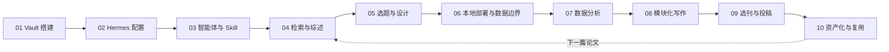

# 第10课｜学术知识积累与资产化

> [!abstract] 🎯 本课定位
> 前九课是“做一项研究”，这一课是“让研究能力沉淀下来”。**同样的十年，有人积累了 10 篇论文 + 1 套方法，有人只有 10 个 Word 文件。**
>
> **学完你将拥有**：一套能抗设备损坏的知识资产、一个会自动跑的文献雷达、一份下学期就能执行的行动计划。

> [!info] 📌 本课的核心判断
> 判断一个研究者是否“有资产”，不看发表数量，看三件事：**能不能 5 秒找到三年前读过的文献；能不能复用上次的分析脚本；能不能说清自己下一篇要做什么。**

---

## 🧰 一、本课软件工具箱（下载 · 备份 · 恢复）

| 工具 | 用途 | 官方地址 | 国内加速 / 说明 | 百度网盘备份 |
| :-- | :-- | :-- | :-- | :-- |
| **Obsidian** | 知识资产主库 | <https://obsidian.md> | 国内可直连 | `/iScholar课程/软件与视频工具箱/01_国产与开源软件工具包/` |
| **Git** | 版本管理（改坏了能回滚） | <https://git-scm.com> | 国内可直连；`brew install git` | 同上（含命令速查） |
| **GitHub / Gitee** | 远程仓库备份 | <https://github.com> / <https://gitee.com> | 国内建议 Gitee | — |
| **坚果云 / OneDrive** | WebDAV 附件同步 | <https://www.jianguoyun.com> | 国内直连 | — |
| **Hermes Cron** | 定时任务（文献雷达） | 随 Hermes 安装 | 已装 | `Obsidian_科研Vault...zip` |
| **Zotero 7** | 题录与 PDF 管理 | <https://www.zotero.org> | 国内可直连 | 同上 |
| **iScholar 工作台** | 一键导出成果到 Vault | 本地 `ischolar/` | 双击即用 | `iScholar_v6.2_...zip` |
| **讯飞智文 / 豆包 / WPS AI** | 汇报与申报材料生产 | <https://zhiwen.xfyun.cn> / <https://www.doubao.com> / <https://www.wps.cn> | 国内直连 | 同上 |

> [!example] 🎬 配套实操视频
> - **`01_iScholar本地工作台_双击启动与DeepSeek秘钥配置教程.mp4`**：把前面所有成果一键导出到 Vault。
> - **`02_Obsidian科研Vault与Hermes智能体配置教程.mp4`**：让 Agent 长期在你的 Vault 里工作。
> - **`14_讯飞智文_豆包与WPS_AI学术汇报PPT生成与美化实战.mp4`**：把积累的成果快速转成汇报与申报材料。

---

## 💎 二、什么是科研资产

### 2.1 六类资产

| 类型 | 具体内容 | 常见丢失方式 |
| :-- | :-- | :-- |
| 📄 **论文资产** | 已发表、在写、投稿记录、审稿意见 | 换电脑、邮箱失效 |
| 📊 **数据资产** | 原始数据、清洗后数据、分析代码、图表 | 只存桌面、无备份 |
| 💻 **代码资产** | 清洗脚本、可视化脚本、自动化流程 | 没有版本管理，改坏即失 |
| 🤖 **模型资产** | 提示词、Skills、Profile 配置 | 散落在聊天记录里 |
| 📝 **笔记资产** | 文献笔记、研究日志、思考记录 | 只存在脑子里 |
| 👥 **关系资产** | 合作者、审稿人、师门 | 无维护 |

### 2.2 资产化的三个动作

```text
1. 集中：所有东西进一个可检索的库（Vault）
2. 版本：关键文件进 Git，改动可回滚
3. 复用：把方法写成 Skill / 模板，下次直接调用
```

> [!warning] 反面清单：这些行为等于没有资产
> - 数据只存桌面，文件名是 `最终版_final_真的最终.docx`
> - 提示词存在微信收藏里，三个月后找不到
> - 分析脚本改一次覆盖一次，出错无法回退
> - 文献笔记只写“这篇文章很好”，没写好在哪

---

## 🔁 三、Obsidian 长期知识系统

### 3.1 每日科研日志（Daily Note）

```markdown
---
date: 2026-11-15
tags: [daily-note]
---

# 2026-11-15 科研日志

## 今日任务
- [ ] 修订方法部分第 3 段
- [ ] 核对 5 条参考文献 DOI

## 今日阅读
- 张三(2024)：AI 反馈的核验机制 —— 可引讨论部分
- Wang(2023)：准实验设计 —— 方法可借鉴

## 今日思考
- "核验行为"这个构念是否可以拆成"查证"与"采纳"两个维度？

## 明日计划
- 完成方法部分初稿
```

> [!tip] 日志只写三件事
> **今天做了什么、读到什么、想到什么。** 不要写成待办清单的搬运工。

### 3.2 知识卡片（Zettelkasten 简化版）

```markdown
---
title: 反馈采纳的两种路径
type: concept-card
tags: [概念卡, 反馈, AI写作]
---

# 反馈采纳的两种路径

## 核心观点
学习者对 AI 反馈的处理可区分「直接采纳」与「核验后采纳」，
前者速度快但错误率高，后者慢但迁移性强。

## 来源
- [[张三2024aigc]]
- [[Li2024feedback]]

## 我的判断
在高校教师群体中，核验后采纳的比例可能与学科训练强度相关。

## 可用于
- 讨论部分的理论解释
- 下一篇论文的 RQ 来源
```

### 3.3 双向链接的三个用法

| 用法 | 写法 | 效果 |
| :-- | :-- | :-- |
| 文献互引 | `[[张三2024aigc]]` | 图谱上看到文献聚类 |
| 概念关联 | `[[反馈采纳]]` | 跨文献找到同一概念 |
| 项目关联 | `[[课题_中阿旅游叙事]]` | 一个课题的所有材料自动聚合 |

### 3.4 图谱怎么用（而不是看）

```text
1. 打开 Graph View，按 tag 过滤（如 #概念卡）
2. 找"孤岛节点"——没有任何连接的笔记，通常是没整理完的
3. 找"枢纽节点"——连接数最多的概念，往往是你研究的核心
4. 把图谱截图放进开题报告，说明理论框架的来源
```

---

## 🔒 四、版本管理与备份（防丢三条线）

### 4.1 三条线，缺一不可

| 线 | 工具 | 防什么 |
| :-- | :-- | :-- |
| 本地版本 | Git | 改坏了能回滚 |
| 远程仓库 | Gitee / GitHub 私有库 | 电脑坏了能恢复 |
| 附件同步 | 坚果云 WebDAV / 移动硬盘 | PDF、数据、录音不丢 |

### 4.2 Git 初始化（Vault 根目录）

```bash
cd ~/Obsidian/科研Vault

git init
cat > .gitignore <<'EOF'
.obsidian/workspace.json
.obsidian/workspace-mobile.json
.trash/
.DS_Store
*.tmp
EOF

git add .
git commit -m "初始化科研 Vault"
```

### 4.3 推到 Gitee（国内更快）

```bash
# 先在 gitee.com 建一个私有仓库，复制地址
git remote add origin https://gitee.com/你的用户名/research-vault.git
git branch -M main
git push -u origin main
```

> [!warning] 私有仓库 + 不含敏感数据
> - 仓库必须设为**私有**。
> - **不要**把访谈原始录音、学生个人信息、未脱敏数据放进 Git。
> - 大文件（PDF、视频）不要进 Git，用 `.gitignore` 排除或 Git LFS。

### 4.4 日常提交习惯

```bash
# 每天收工前
git add -A
git commit -m "2026-11-15 完成方法部分初稿"
git push
```

> [!tip] 提交信息写“做了什么”
> `修改` 是无用信息；`完成方法部分第3段并补5条文献` 才有用，三个月后能看懂。

### 4.5 恢复演练（每学期一次）

```bash
# 模拟误删：查看历史
git log --oneline -10

# 恢复某个文件到指定版本
git checkout <commit-hash> -- 05-写作草稿/02_方法.md
```

> [!success] 真正的备份是“演练过的备份”
> 没试过恢复的备份，等于没有备份。

---

## ⏰ 五、Hermes Cron：让文献雷达自动跑

### 5.1 什么是 Cron 任务

让 Agent 按固定时间自动执行某个 Skill，例如：每周一早 8 点检索“生成式 AI + 外语教学”的新文献，把摘要写进 Vault。

### 5.2 配置示例

```bash
hermes cron create \
  --name "weekly-lit-scan" \
  --schedule "0 8 * * 1" \
  --prompt "检索近 7 天'生成式AI + 外语教学'相关的新文献，按主题分类，输出到 02-文献库/雷达/$(date +%Y-%m-%d).md。只列出能核验的真实条目，不确定的标注'待核验'。"
```

### 5.3 常用周期

| 需求 | 表达式 | 含义 |
| :-- | :-- | :-- |
| 每周一早上 8 点 | `0 8 * * 1` | 周报式扫描 |
| 每天早上 7 点 | `0 7 * * *` | 日报式扫描 |
| 每月 1 号 | `0 9 1 * *` | 月度汇总 |

> [!warning] 自动化不等于可信
> Cron 产出的文献列表仍然要人工核验。**建议让它只做“候选清单”，不要直接写入参考文献库。**

### 5.4 更稳的替代方案

如果 Cron 配置麻烦，可以用“每周手动跑一次固定提示词”，效果接近，风险更低。

---

## 📋 六、科研资产清单（自查表）

### 6.1 按资产类型自查

| 资产 | 是否有 | 存放位置 | 是否有备份 | 是否可复用 |
| :-- | :--: | :-- | :--: | :--: |
| 论文各版本 | ☐ | `05-写作草稿/` | ☐ | — |
| 投稿记录 | ☐ | `06-投稿管理/` | ☐ | ☐ |
| 审稿意见与回复 | ☐ | `06-投稿管理/` | ☐ | ☐ |
| 原始数据（只读） | ☐ | `04-数据与分析/原始/` | ☐ | — |
| 清洗脚本 | ☐ | `04-数据与分析/scripts/` | ☐ | ☐ |
| 图表源文件 | ☐ | `04-数据与分析/figures/` | ☐ | ☐ |
| 提示词库 | ☐ | `08-知识卡片/提示词/` | ☐ | ☐ |
| Hermes Skills | ☐ | `skills/` 或 `~/.hermes/skills/` | ☐ | ☐ |
| 文献笔记 | ☐ | `02-文献库/` | ☐ | ☐ |
| 概念卡 | ☐ | `08-知识卡片/` | ☐ | ☐ |
| 课题申报材料 | ☐ | `07-课题档案/` | ☐ | ☐ |
| 汇报 PPT | ☐ | `07-课题档案/汇报/` | ☐ | ☐ |

### 6.2 三个“5 秒测试”

```text
测试1：5 秒内找到三年前读过的一篇文献笔记 → 找不到，说明检索结构有问题
测试2：5 秒内找到上次用的分析脚本 → 找不到，说明代码资产没归档
测试3：5 秒内说清下一篇论文的 RQ → 说不清，说明选题池没维护
```

---

## 🧭 七、个人 AI 工具组合（按任务选工具）

### 7.1 一张表定组合

| 任务 | 首选 | 备选 | 不要用 |
| :-- | :-- | :-- | :-- |
| 选题发散 | DeepSeek | 通义千问 | 本地 3B（发散能力弱） |
| 文献检索策略 | DeepSeek + 知网 | Semantic Scholar | 让 AI 直接列文献 |
| 全文获取 | Unpaywall + CORE | 图书馆馆际互借 | Sci-Hub |
| 题录管理 | Zotero 7 + Better BibTeX | EndNote | 手动敲参考文献 |
| 质性编码 | Taguette | NVivo | 让 AI 直接出结论 |
| 统计分析 | jamovi / JASP | SPSSAU / Python | 不检验前提直接跑 |
| 中文润色 | 秘塔写作猫 | DeepSeek | 翻译软件来回翻 |
| 英文润色 | Writefull + Paperpal | Grammarly | QuillBot 全文改写 |
| 查重 | PaperPass（中文） | 期刊指定系统 | 不做查重直接投 |
| PPT | 讯飞智文 + WPS AI | 豆包 | 直接使用生成图当数据图 |
| 敏感材料 | 本地 Ollama | 校内平台 | 任何外部 API |
| 版本管理 | Git + Gitee | 移动硬盘 | 只存桌面 |

### 7.2 三档配置方案

| 方案 | 成本 | 适合 | 组合 |
| :-- | :-- | :-- | :-- |
| **极简版** | 0 元 | 刚起步 | DeepSeek 免费版 + Obsidian + Zotero + jamovi |
| **标准版** | 约 50–100 元/月 | 有在研课题 | 上述 + DeepSeek API + Paperpal + 讯飞智文会员 |
| **敏感数据版** | 一次性硬件投入 | 涉密/未公开数据 | 标准版 + 本地 Ollama（16GB+ 机器） |

---

## 🧪 八、课程收束：把 10 课串成一条线

### 8.1 全流程回顾



### 8.2 每课留下的“可复用件”

| 课 | 可复用件 | 下次怎么用 |
| :-- | :-- | :-- |
| 01 | Vault 结构 + 5 模板 | 新课题直接复制 |
| 02 | Profile 配置 | 换模型只改 config |
| 03 | 6 个 Skills | 换学科只改例子 |
| 04 | 检索式 + 文献矩阵 | 新主题换关键词 |
| 05 | 一页纸 + 路线图 | 每个新课题重填一次 |
| 06 | 数据边界清单 | 每次处理新材料前对照 |
| 07 | 分析脚本 + 方法速查表 | 同类数据直接跑 |
| 08 | 各模块提示词 | 按章节调用 |
| 09 | 选刊表 + Cover Letter 模板 | 换刊只改契合段 |
| 10 | Git + Cron + 资产清单 | 长期维护 |

---

## 🧪 九、课堂实操与验收

### 9.1 任务卡

- [ ] 为 Vault 初始化 Git，完成首次提交
- [ ] 推到 Gitee 私有仓库（或至少本地 + 移动硬盘双备份）
- [ ] 做一次“误删恢复”演练
- [ ] 配置 1 个 Cron 任务（或写一份手动周检清单）
- [ ] 填完科研资产清单，标出 3 个缺口
- [ ] 完成个人 AI 工具组合表
- [ ] 写下学期 3 个月行动计划（含 1 个可交付成果）

### 9.2 下学期行动计划模板

```markdown
## 目标（3 个月）
- 完成 [论文题目] 初稿并投出 1 家期刊

## 分解
| 月份 | 任务 | 交付物 | 验收 |
| :-- | :-- | :-- | :-- |
| 第1月 | 文献补充 + 研究设计定稿 | 文献矩阵 30 篇、一页纸 | 导师/同行评审一次 |
| 第2月 | 数据收集与分析 | 清洗数据、结果表 | 前提检验通过 |
| 第3月 | 写作与投稿 | 初稿、Cover Letter | 完成查重与投稿 |

## 支持需求
- [ ] 需要校内 L20 算力（如有）
- [ ] 需要伦理审查（如涉及学生数据）
```

> [!success] ✅ 本课验收标准
> | 项目 | 合格线 |
> | :-- | :-- |
> | 版本管理 | Git 可用，至少 3 次提交记录 |
> | 备份 | 本地 + 远程（或硬盘）双份 |
> | 恢复演练 | 能成功恢复 1 个文件 |
> | 自动化 | 1 个 Cron 或 1 份周检清单 |
> | 资产清单 | 12 项已盘点，缺口清晰 |
> | 行动计划 | 3 个月，有可验收交付物 |

---

## ❓ 十、常见问题

> [!question] Q1：Git 对文科老师是不是太重？
> 前期有 1 小时学习成本，之后每天两条命令。它解决的是“改坏了回不去”这个真实痛点。不想用 Git，至少要做到每日增量备份。

> [!question] Q2：Vault 越来越大，Obsidian 变卡怎么办？
> ①PDF 用链接文件，不要放进 Vault；②关闭不必要的插件；③Dataview 查询限定目录；④把旧课题归档到独立 Vault。

> [!question] Q3：Cron 任务会不会乱改我的笔记？
> 会，如果给了 `write_file` 又不限定目录。建议让它只写 `02-文献库/雷达/`，并且只输出候选清单。

> [!question] Q4：怎么保证三年后还能看懂自己的笔记？
> 三条：①frontmatter 字段统一；②概念卡写“我的判断”而不只是摘抄；③重要决策写进日志（为什么放弃某个选题）。

> [!question] Q5：课程结束后，最该坚持的三件事是什么？
> ①每天一条科研日志；②每篇文献进 Zotero 并写一句“与我何关”；③每周一次 Git 提交。

> [!question] Q6：AI 工具更新太快，跟不上怎么办？
> 不要追工具，追**任务**。把“我要完成什么”写清楚，工具只是替换项。本课的工具组合表就是为此设计的。

---

## 📎 十一、结课交付物

| 交付物 | 位置 |
| :-- | :-- |
| 版本化 Vault | `~/Obsidian/科研Vault`（Git 管理） |
| 资产清单 | `07-课题档案/科研资产清单.md` |
| 工具组合表 | `07-课题档案/AI工具组合表.md` |
| 行动计划 | `07-课题档案/下学期计划.md` |
| 全课程成果包 | 按第 09 课投稿包清单整理 |

---

> [!quote] 本课一句话
> **研究的复利不在论文数量，而在你每次都能站在上一次的基础上往前一步。**
